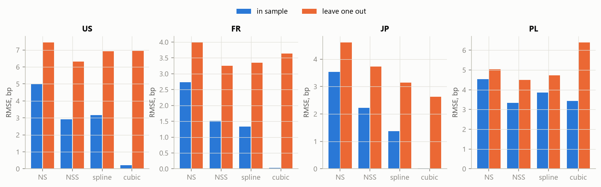

# Curve fitting across markets and regimes

**Question.** Which curve model fits government yields best out of sample, and which is
stable enough to use day after day?

**Data.** Market-based observations only: US Treasury par yields (CMT, 1990-2026), French
TEC yields (2004-2026), Japanese MoF yields (1990-2026), all constant-maturity par yields,
and Polish government bonds bond by bond from the BondSpot fixing (2006-2026, weekly).
German and UK inputs are themselves central-bank model curves, so fitting them would only
measure one model's ability to copy another; they are left out here.

**Method.** 5,608 fits (4 models at every month end; none failed). In-sample RMSE in bp of
the observed yields; leave-one-out RMSE at quarter ends (each interior point dropped,
refitted, predicted); stability on 60 consecutive observations at the end of each regime
(see docs/METHODOLOGY.md, section 2).

## Results

Median RMSE across dates (bp):

| market | in-sample ns | in-sample nss | in-sample spline | in-sample cubic | leave-one-out ns | leave-one-out nss | leave-one-out spline | leave-one-out cubic |
|---|---:|---:|---:|---:|---:|---:|---:|---:|
| FR | 2.74 | 1.52 | 1.33 | 0.03 | 3.98 | 3.25 | 3.34 | 3.63 |
| JP | 3.54 | 2.23 | 1.38 | 0.02 | 4.60 | 3.73 | 3.14 | 2.62 |
| PL | 4.54 | 3.33 | 3.85 | 3.44 | 5.03 | 4.49 | 4.73 | 6.38 |
| US | 4.99 | 2.92 | 3.17 | 0.22 | 7.43 | 6.31 | 6.93 | 6.94 |

- Out of sample, the lowest error is: FR Svensson (3.25 bp), JP cubic spline (2.62 bp), PL Svensson (4.49 bp), US Svensson (6.31 bp).
- Nelson-Siegel, with a single hump, has the highest leave-one-out error in
  FR, JP, US.
- The cubic spline fits the inputs exactly (in-sample error near zero for par data) but
  interpolates worse than Svensson where tenors are sparse: US 6.94 bp vs
  6.31 bp. In Japan, where yearly tenors from 1 to 10 years are published, it
  interpolates best. For Polish bonds it is the worst (6.38 bp): an
  interpolant through noisy bond yields passes the noise on.
- Errors depend on the regime. The largest Svensson error is in PL, pre-2008.

Leave-one-out RMSE by regime (bp, median):

| market | regime | ns | nss | spline | cubic |
|---|---|---:|---:|---:|---:|
| FR | 2008-14 crisis and QE | 5.42 | 3.93 | 3.80 | 4.77 |
| FR | 2015-21 low and negative rates | 3.81 | 2.79 | 2.42 | 2.63 |
| FR | 2022-26 inflation and tightening | 4.19 | 3.33 | 3.95 | 4.10 |
| FR | pre-2008 | 2.28 | 2.62 | 1.99 | 2.44 |
| JP | 2008-14 crisis and QE | 5.16 | 3.62 | 2.70 | 2.29 |
| JP | 2015-21 low and negative rates | 2.94 | 2.12 | 1.90 | 1.68 |
| JP | 2022-26 inflation and tightening | 4.12 | 3.67 | 2.55 | 2.51 |
| JP | pre-2008 | 5.15 | 4.93 | 4.11 | 3.64 |
| PL | 2008-14 crisis and QE | 5.14 | 4.54 | 4.95 | 6.44 |
| PL | 2015-21 low and negative rates | 3.96 | 3.65 | 3.61 | 6.24 |
| PL | 2022-26 inflation and tightening | 5.64 | 5.14 | 5.75 | 7.85 |
| PL | pre-2008 | 8.20 | 7.88 | 8.09 | 5.47 |
| US | 2008-14 crisis and QE | 6.67 | 4.39 | 6.80 | 6.48 |
| US | 2015-21 low and negative rates | 4.55 | 4.23 | 4.55 | 4.16 |
| US | 2022-26 inflation and tightening | 8.49 | 6.49 | 8.92 | 9.92 |
| US | pre-2008 | 9.02 | 7.59 | 8.02 | 9.01 |

## Stability

Excess day-to-day noise at maturities that are not observed (lower is steadier):

| market | regime | ns | nss | spline | cubic |
|---|---|---:|---:|---:|---:|
| FR | 2008-14 crisis and QE | 0.131 | 0.096 | 0.055 | 0.115 |
| FR | 2015-21 low and negative rates | 0.125 | 0.099 | 0.048 | 0.073 |
| FR | 2022-26 inflation and tightening | 0.086 | 0.057 | 0.034 | 0.075 |
| FR | pre-2008 | 0.079 | 0.063 | 0.037 | 0.047 |
| JP | 2008-14 crisis and QE | 0.082 | 0.081 | 0.062 | 0.117 |
| JP | 2015-21 low and negative rates | 0.202 | 0.378 | 0.175 | 0.338 |
| JP | 2022-26 inflation and tightening | 0.177 | 0.069 | 0.038 | 0.077 |
| JP | pre-2008 | 0.092 | 0.130 | 0.044 | 0.085 |
| US | 2008-14 crisis and QE | 0.091 | 0.074 | 0.048 | 0.081 |
| US | 2015-21 low and negative rates | 0.137 | 0.110 | 0.062 | 0.092 |
| US | 2022-26 inflation and tightening | 0.251 | 0.049 | 0.042 | 0.071 |
| US | pre-2008 | 0.180 | 0.123 | 0.050 | 0.057 |

The smoothing spline is the steadiest model in 12 of 12 market-regime cells.
Svensson's taus can jump between nearby local optima when the two humps are close; the same
happens in official curves (Bundesbank and ECB taus are within 0.13 and 0.04 years on 5% of
days since 2000), so parameters should not be read as stable economic quantities even when
the fitted curve is.

## Takeaways

- For relative-value work on par data, Svensson is the best single default out of sample
  and the smoothing spline the best when day-to-day stability of unobserved points matters
  (for example, rich/cheap signals that compare fitted and observed yields daily).
- A curve that reproduces its inputs exactly (bootstrap or interpolating spline) says
  nothing about fit quality; judge models only out of sample.

Full tables: [generated/01_curve_fitting.md](generated/01_curve_fitting.md), raw results in
`generated/fit_errors.csv`, `fit_loo.csv`, `fit_stability.csv`.
