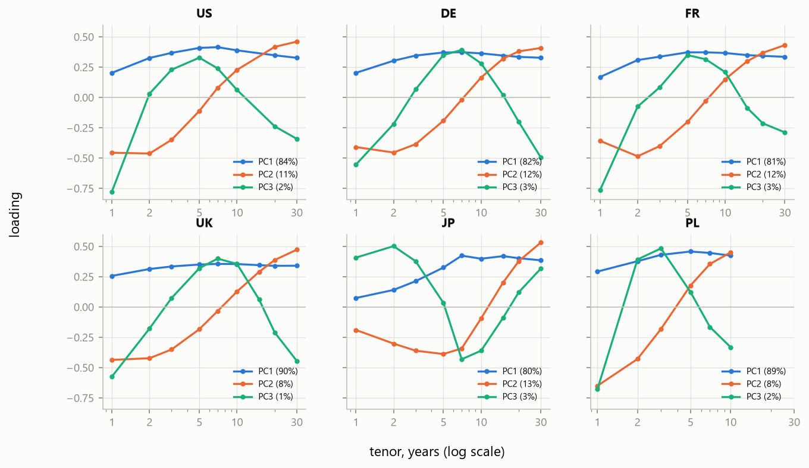

# Principal components of curve moves

**Question.** How many factors drive each curve, are they the same across markets and
regimes, and what were the largest moves?

**Data and method.** Daily changes of par yields (weekly for Poland) at fixed tenors since
2000; PCA of changes in bp. Changes are never taken across a data gap (the US 30-year CMT
was not published from February 2002 to February 2006; the Bank of England curve goes beyond
25 years only from 2016, so UK results start then). Rolling two-year windows every six months
are compared with the full-sample loadings by the cosine of the angle between them.

## Shares of variance and volatility (full sample)

| market | n | expl_PC1 | expl_PC2 | expl_PC3 | vol_PC1_bp | vol_PC2_bp | vol_PC3_bp |
|---|---:|---:|---:|---:|---:|---:|---:|
| US | 5729 | 84.39 | 11.15 | 2.33 | 14.31 | 5.20 | 2.38 |
| DE | 6683 | 82.07 | 12.48 | 2.68 | 12.41 | 4.84 | 2.24 |
| FR | 5145 | 81.17 | 11.84 | 2.88 | 12.40 | 4.74 | 2.34 |
| UK | 2750 | 90.09 | 8.21 | 1.28 | 15.10 | 4.56 | 1.80 |
| JP | 6584 | 80.45 | 12.92 | 3.24 | 5.80 | 2.32 | 1.16 |
| PL | 1071 | 89.46 | 7.60 | 1.98 | 33.53 | 9.78 | 4.99 |

Level (PC1) explains 80-90% of daily variance in every market. Slope is
largest in Japan and the US; curvature is small everywhere. Daily level volatility in Poland
(weekly data, so not directly comparable) and in the 2022-26 regime everywhere is much higher
than in the low-rate years.

## Stability

By regime (share of variance in %, volatility in bp, cosine with full-sample loadings):

| market | regime | expl_PC1 | expl_PC2 | vol_PC1_bp | vol_PC2_bp | cos_PC1 | cos_PC2 | cos_PC3 |
|---|---|---:|---:|---:|---:|---:|---:|---:|
| US | pre-2008 | 86.639 | 9.134 | 14.923 | 4.845 | 0.988 | 0.979 | 0.935 |
| US | 2008-14 crisis and QE | 84.323 | 10.725 | 15.394 | 5.490 | 0.993 | 0.990 | 0.983 |
| US | 2015-21 low and negative rates | 86.283 | 8.891 | 10.636 | 3.414 | 0.986 | 0.957 | 0.971 |
| US | 2022-26 inflation and tightening | 86.772 | 10.054 | 16.998 | 5.786 | 0.992 | 0.990 | 0.992 |
| DE | pre-2008 | 78.370 | 13.030 | 11.889 | 4.848 | 0.996 | 0.984 | 0.873 |
| DE | 2008-14 crisis and QE | 81.997 | 13.073 | 13.527 | 5.401 | 1.000 | 1.000 | 0.996 |
| DE | 2015-21 low and negative rates | 87.775 | 8.092 | 8.925 | 2.710 | 0.938 | 0.892 | 0.902 |
| DE | 2022-26 inflation and tightening | 88.415 | 8.617 | 15.895 | 4.962 | 0.997 | 0.994 | 0.905 |
| FR | pre-2008 | 87.321 | 8.345 | 10.715 | 3.312 | 0.998 | 0.972 | 0.867 |
| FR | 2008-14 crisis and QE | 77.867 | 12.863 | 13.157 | 5.348 | 0.999 | 0.999 | 0.978 |
| FR | 2015-21 low and negative rates | 87.112 | 8.150 | 8.591 | 2.628 | 0.945 | 0.915 | 0.930 |
| FR | 2022-26 inflation and tightening | 85.773 | 8.819 | 16.141 | 5.176 | 0.996 | 0.992 | 0.885 |
| UK | 2015-21 low and negative rates | 91.272 | 6.926 | 10.592 | 2.918 | 0.988 | 0.987 | 0.985 |
| UK | 2022-26 inflation and tightening | 90.604 | 7.829 | 19.336 | 5.684 | 0.998 | 0.998 | 0.996 |
| JP | pre-2008 | 85.921 | 9.630 | 6.986 | 2.339 | 0.999 | 0.986 | 0.983 |
| JP | 2008-14 crisis and QE | 75.076 | 16.629 | 5.071 | 2.386 | 0.996 | 0.986 | 0.972 |
| JP | 2015-21 low and negative rates | 77.606 | 14.297 | 3.931 | 1.687 | 0.992 | 0.982 | 0.976 |
| JP | 2022-26 inflation and tightening | 78.977 | 15.152 | 6.812 | 2.984 | 0.998 | 0.990 | 0.962 |
| PL | pre-2008 | 89.018 | 7.619 | 21.558 | 6.307 | 1.000 | 0.999 | 0.980 |
| PL | 2008-14 crisis and QE | 86.542 | 10.032 | 28.080 | 9.561 | 1.000 | 1.000 | 0.995 |
| PL | 2015-21 low and negative rates | 84.866 | 11.257 | 20.136 | 7.334 | 0.980 | 0.971 | 0.949 |
| PL | 2022-26 inflation and tightening | 92.406 | 5.282 | 54.211 | 12.961 | 1.000 | 0.991 | 0.990 |

Rolling two-year windows, cosine with the full-sample loadings:

| market | cos_PC1 min | cos_PC1 median | cos_PC2 min | cos_PC2 median | cos_PC3 min | cos_PC3 median |
|---|---:|---:|---:|---:|---:|---:|
| DE | 0.88 | 0.99 | 0.81 | 0.98 | 0.20 | 0.90 |
| FR | 0.90 | 0.99 | 0.80 | 0.98 | 0.52 | 0.93 |
| JP | 0.95 | 0.99 | 0.81 | 0.96 | 0.57 | 0.93 |
| PL | 0.93 | 0.98 | 0.90 | 0.97 | 0.73 | 0.97 |
| UK | 0.97 | 1.00 | 0.96 | 0.99 | 0.89 | 0.98 |
| US | 0.90 | 0.99 | 0.73 | 0.98 | 0.33 | 0.95 |

Level and slope are stable shapes. Curvature is not: in some windows its loadings point in a
different direction altogether, so a "PC3 trade" estimated on one period can carry level or
slope risk in the next. This matters for PCA-weighted butterflies (see the strategy study).

## Largest three-month moves in level and slope

Found from the data (largest non-overlapping three-month sums of each factor's scores),
then decomposed. These moves are offered as historical scenarios in the terminal.

| market | factor | start | end | change |
|---|---|---|---|---|
| US | PC1 | 2022-08-04 | 2022-11-07 | 1y +169, 2y +169, 3y +168, 5y +163, 7y +158, 10y +154, 20y +140, 30y +137 |
| US | PC1 | 2008-09-23 | 2008-12-29 | 1y -165, 2y -133, 3y -144, 5y -158, 7y -166, 10y -172, 20y -156, 30y -180 |
| US | PC1 | 2022-03-11 | 2022-06-14 | 1y +193, 2y +170, 3y +169, 5y +165, 7y +159, 10y +149, 20y +127, 30y +109 |
| US | PC2 | 2007-11-30 | 2008-03-06 | 1y -167, 2y -151, 3y -132, 5y -91, 7y -64, 10y -35, 20y +8, 30y +17 |
| US | PC2 | 2011-06-30 | 2011-10-03 | 1y -7, 2y -21, 3y -42, 5y -89, 7y -117, 10y -138, 20y -158, 30y -162 |
| US | PC2 | 2021-12-29 | 2022-04-01 | 1y +134, 2y +169, 3y +162, 5y +126, 7y +103, 10y +84, 20y +60, 30y +48 |
| DE | PC1 | 2022-08-05 | 2022-11-04 | 1y +177, 2y +179, 3y +174, 5y +165, 7y +159, 10y +150, 15y +137, 20y +129, 30y +121 |
| DE | PC1 | 2008-09-04 | 2008-12-04 | 1y -256, 2y -223, 3y -197, 5y -157, 7y -134, 10y -117, 15y -115, 20y -123, 30y -142 |
| DE | PC1 | 2022-03-15 | 2022-06-16 | 1y +116, 2y +156, 3y +164, 5y +158, 7y +152, 10y +148, 15y +150, 20y +147, 30y +135 |
| DE | PC2 | 2008-08-18 | 2008-11-17 | 1y -220, 2y -182, 3y -152, 5y -105, 7y -73, 10y -42, 15y -23, 20y -19, 30y -24 |
| DE | PC2 | 2008-12-09 | 2009-03-17 | 1y -118, 2y -98, 3y -80, 5y -49, 7y -24, 10y +3, 15y +29, 20y +41, 30y +50 |
| DE | PC2 | 2008-03-05 | 2008-06-09 | 1y +120, 2y +148, 3y +148, 5y +118, 7y +88, 10y +54, 15y +26, 20y +16, 30y +10 |
| FR | PC1 | 2022-03-14 | 2022-06-15 | 1y +125, 2y +195, 3y +179, 5y +159, 7y +162, 10y +155, 15y +154, 20y +153, 30y +141 |
| FR | PC1 | 2022-08-05 | 2022-11-04 | 1y +179, 2y +181, 3y +169, 5y +161, 7y +151, 10y +149, 15y +139, 20y +130, 30y +110 |
| FR | PC1 | 2008-09-23 | 2008-12-23 | 1y -241, 2y -198, 3y -174, 5y -152, 7y -131, 10y -113, 15y -115, 20y -112, 30y -127 |
| FR | PC2 | 2008-08-07 | 2008-11-06 | 1y -182, 2y -152, 3y -129, 5y -98, 7y -65, 10y -23, 15y -17, 20y -5, 30y -13 |
| FR | PC2 | 2008-12-10 | 2009-03-13 | 1y -120, 2y -110, 3y -83, 5y -46, 7y -21, 10y +0, 15y +25, 20y +39, 30y +44 |
| FR | PC2 | 2008-03-05 | 2008-06-09 | 1y +98, 2y +138, 3y +133, 5y +113, 7y +84, 10y +52, 15y +35, 20y +18, 30y +3 |
| UK | PC1 | 2022-07-07 | 2022-10-10 | 1y +228, 2y +264, 3y +278, 5y +279, 7y +266, 10y +244, 15y +230, 20y +229, 30y +221 |
| UK | PC1 | 2023-04-04 | 2023-07-11 | 1y +157, 2y +181, 3y +182, 5y +163, 7y +144, 10y +124, 15y +108, 20y +102, 30y +95 |
| UK | PC1 | 2022-10-10 | 2023-01-12 | 1y -67, 2y -113, 3y -128, 5y -132, 7y -126, 10y -116, 15y -111, 20y -110, 30y -104 |
| UK | PC2 | 2023-03-21 | 2023-06-27 | 1y +170, 2y +185, 3y +178, 5y +150, 7y +127, 10y +103, 15y +81, 20y +68, 30y +57 |
| UK | PC2 | 2022-06-29 | 2022-09-30 | 1y +207, 2y +228, 3y +235, 5y +228, 7y +209, 10y +178, 15y +146, 20y +130, 30y +111 |
| UK | PC2 | 2023-07-06 | 2023-10-06 | 1y -66, 2y -86, 3y -82, 5y -56, 7y -30, 10y -4, 15y +14, 20y +24, 30y +39 |
| JP | PC1 | 2003-06-02 | 2003-09-02 | 1y +3, 2y +22, 3y +45, 5y +83, 7y +107, 10y +108, 15y +104, 20y +102, 30y +100 |
| JP | PC1 | 2000-12-13 | 2001-03-22 | 1y -45, 2y -51, 3y -59, 5y -62, 7y -63, 10y -62, 15y -71, 20y -73, 30y -83 |
| JP | PC1 | 2025-10-10 | 2026-01-20 | 1y +20, 2y +30, 3y +38, 5y +47, 7y +52, 10y +63, 15y +70, 20y +63, 30y +58 |
| JP | PC2 | 2008-03-10 | 2008-06-13 | 1y +28, 2y +49, 3y +68, 5y +79, 7y +75, 10y +52, 15y +44, 20y +32, 30y +16 |
| JP | PC2 | 2025-02-12 | 2025-05-21 | 1y -4, 2y -8, 3y -3, 5y +0, 7y +7, 10y +18, 15y +40, 20y +53, 30y +67 |
| JP | PC2 | 2006-02-03 | 2006-05-11 | 1y +30, 2y +48, 3y +55, 5y +54, 7y +48, 10y +38, 15y +30, 20y +19, 30y +6 |
| PL | PC1 | 2022-03-18 | 2022-06-17 | 1y +247, 2y +263, 3y +290, 5y +309, 7y +308, 10y +322 |
| PL | PC1 | 2022-10-21 | 2023-01-20 | 1y -247, 2y -300, 3y -309, 5y -308, 7y -298, 10y -268 |
| PL | PC1 | 2022-07-22 | 2022-10-21 | 1y +194, 2y +228, 3y +263, 5y +285, 7y +289, 10y +290 |
| PL | PC2 | 2008-10-24 | 2009-01-23 | 1y -246, 2y -248, 3y -243, 5y -208, 7y -171, 10y -133 |
| PL | PC2 | 2022-05-13 | 2022-08-12 | 1y +43, 2y -14, 3y -77, 5y -134, 7y -145, 10y -135 |
| PL | PC2 | 2023-06-30 | 2023-09-29 | 1y -116, 2y -80, 3y -64, 5y -35, 7y -8, 10y +15 |
