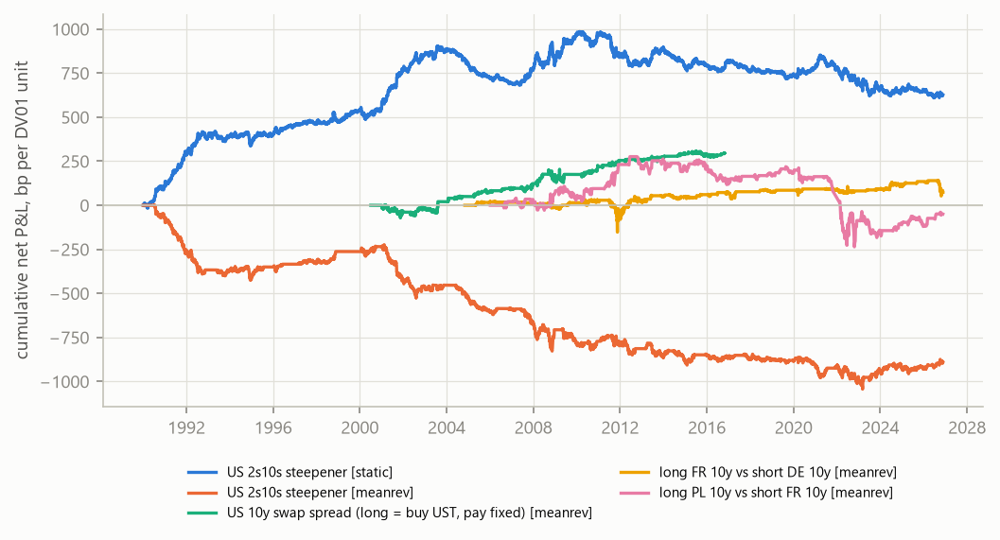

# Relative-value strategies: what survived out of sample

**Question.** Did the standard rates RV signals - fading curve and butterfly dislocations,
cross-country spreads, swap spreads, breakevens, carry - earn money after realistic costs
and out of sample?

**Set-up.** Constant-maturity DV01-weighted trades with carry, roll-down and convexity;
weekly decisions; costs on every trade and a quarterly roll. Signals: mean reversion
(z-score), carry (sign of carry plus roll-down), momentum (control), static. Validation:
first-half/second-half and walk-forward parameter selection. Details: docs/METHODOLOGY.md,
section 6. P&L is in bp per unit of DV01 per year.

## Walk-forward out-of-sample results (mean reversion)

| family | strategy | start | end | ann_return_bp | ann_vol_bp | sharpe | t_nw | cost_bp_per_year |
|---|---|---|---|---:|---:|---:|---:|---:|
| swap spread | US 10y swap spread (long = buy UST, pay fixed) | 2004 | 2016 | 27.01 | 53.67 | 0.50 | 3.80 | 6.79 |
| cross-country | long UK 10y vs short DE 10y | 2001 | 2026 | 16.95 | 65.13 | 0.26 | 2.10 | 10.26 |
| butterfly | US 2s5s10s fly 50/50 (long belly) | 1994 | 2026 | 2.91 | 18.16 | 0.16 | 1.13 | 2.67 |
| butterfly | FR 2s5s10s fly 50/50 (long belly) | 2008 | 2026 | 2.50 | 20.63 | 0.12 | 0.70 | 5.02 |
| cross-country | long JP 10y vs short US 10y | 1994 | 2026 | 8.13 | 76.61 | 0.11 | 0.70 | 7.21 |
| curve | UK 5s30s steepener | 2020 | 2026 | 10.72 | 52.69 | 0.20 | 0.63 | 5.23 |
| swap spread | UK 10y OIS spread (long = buy gilt, pay fixed OIS) | 2020 | 2026 | 2.79 | 25.68 | 0.11 | 0.56 | 4.88 |
| cross-country | long PL 10y vs short FR 10y | 2010 | 2026 | 9.68 | 72.97 | 0.13 | 0.56 | 19.18 |
| breakeven | US 10y breakeven (long TIPS, short nominal) | 2007 | 2026 | 5.94 | 46.74 | 0.13 | 0.53 | 9.56 |
| butterfly | DE 2s5s10s fly 50/50 (long belly) | 2001 | 2026 | 0.79 | 13.45 | 0.06 | 0.37 | 3.36 |
| butterfly | FR 2s5s10s fly PCA-weighted (long belly) | 2008 | 2026 | 1.06 | 22.72 | 0.05 | 0.28 | 8.21 |
| cross-country | long PL 10y vs short DE 10y | 2010 | 2026 | 4.21 | 72.64 | 0.06 | 0.24 | 17.42 |
| breakeven | UK 10y breakeven (long linker, short gilt) | 1994 | 2026 | 1.62 | 38.64 | 0.04 | 0.22 | 6.30 |
| cross-country | long US 10y vs short DE 10y | 2001 | 2026 | 1.48 | 78.23 | 0.02 | 0.16 | 6.00 |
| cross-country | long FR 10y vs short DE 10y | 2008 | 2026 | 1.31 | 43.10 | 0.03 | 0.16 | 6.69 |
| credit | US Baa vs 20y Treasury (long credit, rates-hedged) | 1997 | 2026 | -3.45 | 29.46 | -0.12 | -0.40 | 3.13 |
| curve | FR 5s30s steepener | 2010 | 2026 | -3.69 | 39.28 | -0.09 | -0.44 | 7.17 |
| butterfly | US 2s5s10s fly PCA-weighted (long belly) | 1994 | 2026 | -1.48 | 19.49 | -0.08 | -0.54 | 6.47 |
| curve | DE 5s30s steepener | 2004 | 2026 | -5.68 | 43.90 | -0.13 | -0.68 | 6.19 |
| curve | JP 5s30s steepener | 2003 | 2026 | -6.32 | 28.32 | -0.22 | -1.12 | 6.21 |
| butterfly | JP 2s5s10s fly 50/50 (long belly) | 1994 | 2026 | -1.88 | 11.39 | -0.17 | -1.12 | 6.14 |
| curve | PL 5s10s steepener | 2010 | 2026 | -7.03 | 23.91 | -0.29 | -1.26 | 14.14 |
| curve | US 5s30s steepener | 1997 | 2026 | -14.37 | 56.33 | -0.26 | -1.42 | 4.42 |
| curve | JP 2s10s steepener | 1994 | 2026 | -7.36 | 26.39 | -0.28 | -1.57 | 9.00 |
| curve | DE 2s10s steepener | 2001 | 2026 | -14.91 | 49.78 | -0.30 | -1.68 | 5.12 |
| curve | FR 2s10s steepener | 2008 | 2026 | -20.09 | 53.41 | -0.38 | -1.76 | 6.93 |
| curve | PL 2s5s steepener | 2010 | 2026 | -20.27 | 44.65 | -0.45 | -2.08 | 38.19 |
| butterfly | UK 2s5s10s fly PCA-weighted (long belly) | 1994 | 2026 | -4.16 | 9.65 | -0.43 | -2.22 | 4.23 |
| curve | PL 2s10s steepener | 2010 | 2026 | -32.12 | 61.91 | -0.52 | -2.27 | 38.54 |
| butterfly | DE 2s5s10s fly PCA-weighted (long belly) | 2001 | 2026 | -5.12 | 16.33 | -0.31 | -2.31 | 5.88 |
| curve | UK 2s10s steepener | 1994 | 2026 | -19.42 | 43.67 | -0.44 | -2.32 | 5.11 |
| curve | US 2s10s steepener | 1994 | 2026 | -21.08 | 49.32 | -0.43 | -2.59 | 3.11 |
| butterfly | UK 2s5s10s fly 50/50 (long belly) | 1994 | 2026 | -5.95 | 11.35 | -0.52 | -2.77 | 3.64 |
| butterfly | PL 2s5s10s fly 50/50 (long belly) | 2010 | 2026 | -15.64 | 25.11 | -0.62 | -2.85 | 27.28 |
| butterfly | JP 2s5s10s fly PCA-weighted (long belly) | 1994 | 2026 | -6.95 | 13.45 | -0.52 | -3.24 | 10.53 |
| butterfly | PL 2s5s10s fly PCA-weighted (long belly) | 2010 | 2026 | -26.54 | 30.07 | -0.88 | -4.04 | 33.85 |

36 walk-forward tests were run and 12 have |t| >= 2, far more than the
1.8 that chance alone would produce - but 10 of them are **negative**: those signals
lost money reliably after costs. 2 are positive (US 10y swap spread (long = buy UST, pay fixed), long UK 10y vs short DE 10y). With 36 tests,
a one-sided 5% Bonferroni bar is t = 2.99; only **US 10y swap spread (long = buy UST, pay fixed)** clears it:
27.0 bp per DV01 per year, Sharpe 0.50, t 3.80 (2004-2016).
Its caveats: LIBOR swaps (the market has since moved to SOFR) and a sample that ends in 2016
and includes the 2008 crisis.

Mean reversion of curve slopes **lost money in every market**: 2s10s walk-forward Sharpe
ratios run from -0.52 to -0.28. Slopes are persistent and move with the
policy cycle, so fading a steep or flat curve meant standing against long trends.
Butterflies and cross-country 10y spreads are close to zero or negative after costs; PCA
weighting did not improve butterflies (curvature loadings are unstable, see the PCA note).
Polish trades did not cover the bid/offer measured in the fixing.

## Full sample, all signals (Sharpe ratios, costs x1)

| family | strategy | carry | meanrev | momentum | static |
|---|---|---:|---:|---:|---:|
| breakeven | UK 10y breakeven (long linker, short gilt) | -0.09 | -0.13 | -0.71 | -0.53 |
| breakeven | US 10y breakeven (long TIPS, short nominal) | -0.49 | 0.08 | -0.32 | -0.13 |
| butterfly | DE 2s5s10s fly 50/50 (long belly) | -0.22 | -0.10 | -0.98 | -0.01 |
| butterfly | DE 2s5s10s fly PCA-weighted (long belly) | -0.48 | -0.30 | -0.95 | -0.22 |
| butterfly | FR 2s5s10s fly 50/50 (long belly) | 0.13 | 0.01 | -0.93 | -0.01 |
| butterfly | FR 2s5s10s fly PCA-weighted (long belly) | -0.06 | -0.05 | -1.01 | -0.29 |
| butterfly | JP 2s5s10s fly 50/50 (long belly) | -0.18 | -0.16 | -1.58 | -0.18 |
| butterfly | JP 2s5s10s fly PCA-weighted (long belly) | -0.68 | -0.57 | -1.91 | -0.90 |
| butterfly | PL 2s5s10s fly 50/50 (long belly) | -1.54 | -1.21 | -3.26 | -1.21 |
| butterfly | PL 2s5s10s fly PCA-weighted (long belly) | -2.26 | -1.34 | -3.49 | -1.37 |
| butterfly | UK 2s5s10s fly 50/50 (long belly) | 0.27 | -0.56 | -0.81 | -0.06 |
| butterfly | UK 2s5s10s fly PCA-weighted (long belly) | 0.06 | -0.44 | -1.18 | -0.26 |
| butterfly | US 2s5s10s fly 50/50 (long belly) | 0.22 | 0.04 | -0.70 | -0.09 |
| butterfly | US 2s5s10s fly PCA-weighted (long belly) | 0.17 | 0.00 | -0.83 | -0.30 |
| carry | cross-country 10y carry/vol (long best, short worst) | 0.19 |  |  |  |
| credit | US Baa vs 20y Treasury (long credit, rates-hedged) | 0.19 | -0.43 | 0.54 | 0.19 |
| cross-country | long FR 10y vs short DE 10y | -0.05 | 0.08 | -0.62 | -0.14 |
| cross-country | long JP 10y vs short US 10y | 0.05 | 0.05 | -0.44 | -0.14 |
| cross-country | long PL 10y vs short DE 10y | -0.14 | -0.07 | -0.87 | -0.19 |
| cross-country | long PL 10y vs short FR 10y | -0.14 | -0.03 | -1.05 | -0.20 |
| cross-country | long UK 10y vs short DE 10y | 0.26 | 0.16 | -0.65 | -0.20 |
| cross-country | long US 10y vs short DE 10y | 0.06 | 0.04 | -0.40 | -0.07 |
| curve | DE 2s10s steepener | -0.04 | -0.38 | 0.14 | -0.32 |
| curve | DE 5s30s steepener | 0.03 | -0.20 | -0.18 | 0.04 |
| curve | FR 2s10s steepener | 0.45 | -0.44 | 0.20 | -0.36 |
| curve | FR 5s30s steepener | 0.09 | -0.17 | -0.27 | 0.11 |
| curve | JP 2s10s steepener | 0.35 | -0.36 | -0.54 | -0.13 |
| curve | JP 5s30s steepener | 0.04 | -0.33 | -0.55 | -0.16 |
| curve | PL 2s10s steepener | -1.08 | -0.90 | -1.75 | -0.47 |
| curve | PL 2s5s steepener | -1.26 | -0.89 | -2.06 | -0.77 |
| curve | PL 5s10s steepener | -0.96 | -0.90 | -2.20 | -0.63 |
| curve | UK 2s10s steepener | 0.16 | -0.25 | -0.18 | -0.11 |
| curve | UK 5s30s steepener | -0.41 | 0.10 | -0.42 | -0.39 |
| curve | US 2s10s steepener | 0.12 | -0.47 | 0.05 | 0.29 |
| curve | US 5s30s steepener | 0.13 | -0.03 | -0.09 | 0.24 |
| swap spread | UK 10y OIS spread (long = buy gilt, pay fixed OIS) | 0.03 | -0.19 | -0.72 | 0.03 |
| swap spread | US 10y swap spread (long = buy UST, pay fixed) | 0.13 | 0.28 | -0.68 | -0.19 |

The carry signal is mildly positive for some curve trades (French and Japanese 2s10s) but
not consistently. The static US steepeners earned their carry and roll-down plus a secular
steepening; that is a risk premium with long drawdowns, not relative value. Momentum, the
control, is negative almost everywhere.

## Costs

Mean reversion, Sharpe ratio at 0x, 1x and 2x the cost assumptions:

| strategy | full sample, costs x0 | full sample, costs x1 | full sample, costs x2 |
|---|---:|---:|---:|
| DE 2s10s steepener | -0.28 | -0.38 | -0.48 |
| DE 2s5s10s fly 50/50 (long belly) | 0.19 | -0.10 | -0.38 |
| DE 2s5s10s fly PCA-weighted (long belly) | 0.03 | -0.30 | -0.61 |
| DE 5s30s steepener | -0.07 | -0.20 | -0.32 |
| FR 2s10s steepener | -0.30 | -0.44 | -0.58 |
| FR 2s5s10s fly 50/50 (long belly) | 0.30 | 0.01 | -0.28 |
| FR 2s5s10s fly PCA-weighted (long belly) | 0.27 | -0.05 | -0.36 |
| FR 5s30s steepener | 0.02 | -0.17 | -0.35 |
| JP 2s10s steepener | -0.12 | -0.36 | -0.60 |
| JP 2s5s10s fly 50/50 (long belly) | 0.43 | -0.16 | -0.69 |
| JP 2s5s10s fly PCA-weighted (long belly) | 0.22 | -0.57 | -1.18 |
| JP 5s30s steepener | 0.02 | -0.33 | -0.66 |
| PL 2s10s steepener | -0.16 | -0.90 | -1.41 |
| PL 2s5s steepener | 0.34 | -0.89 | -1.59 |
| PL 2s5s10s fly 50/50 (long belly) | 0.85 | -1.21 | -1.95 |
| PL 2s5s10s fly PCA-weighted (long belly) | 0.75 | -1.34 | -2.00 |
| PL 5s10s steepener | 0.10 | -0.90 | -1.51 |
| UK 10y OIS spread (long = buy gilt, pay fixed OIS) | -0.00 | -0.19 | -0.38 |
| UK 10y breakeven (long linker, short gilt) | 0.07 | -0.13 | -0.33 |
| UK 2s10s steepener | -0.14 | -0.25 | -0.35 |
| UK 2s5s10s fly 50/50 (long belly) | -0.16 | -0.56 | -0.92 |
| UK 2s5s10s fly PCA-weighted (long belly) | 0.05 | -0.44 | -0.86 |
| UK 5s30s steepener | 0.25 | 0.10 | -0.05 |
| US 10y breakeven (long TIPS, short nominal) | 0.31 | 0.08 | -0.15 |
| US 10y swap spread (long = buy UST, pay fixed) | 0.35 | 0.28 | 0.21 |
| US 2s10s steepener | -0.40 | -0.47 | -0.53 |
| US 2s5s10s fly 50/50 (long belly) | 0.24 | 0.04 | -0.15 |
| US 2s5s10s fly PCA-weighted (long belly) | 0.25 | 0.00 | -0.25 |
| US 5s30s steepener | 0.07 | -0.03 | -0.13 |
| US Baa vs 20y Treasury (long credit, rates-hedged) | -0.28 | -0.43 | -0.58 |
| long FR 10y vs short DE 10y | 0.21 | 0.08 | -0.05 |
| long JP 10y vs short US 10y | 0.12 | 0.05 | -0.03 |
| long PL 10y vs short DE 10y | 0.13 | -0.07 | -0.27 |
| long PL 10y vs short FR 10y | 0.20 | -0.03 | -0.25 |
| long UK 10y vs short DE 10y | 0.25 | 0.16 | 0.06 |
| long US 10y vs short DE 10y | 0.10 | 0.04 | -0.02 |

## Not tested

Treasury futures basis: no free settlement prices could be used, so the basis module
(conversion factors, CTD, gross and net basis, implied repo) is analytics only.

Full tables: [generated/03_strategies.md](generated/03_strategies.md) and `generated/strategies.csv`.
