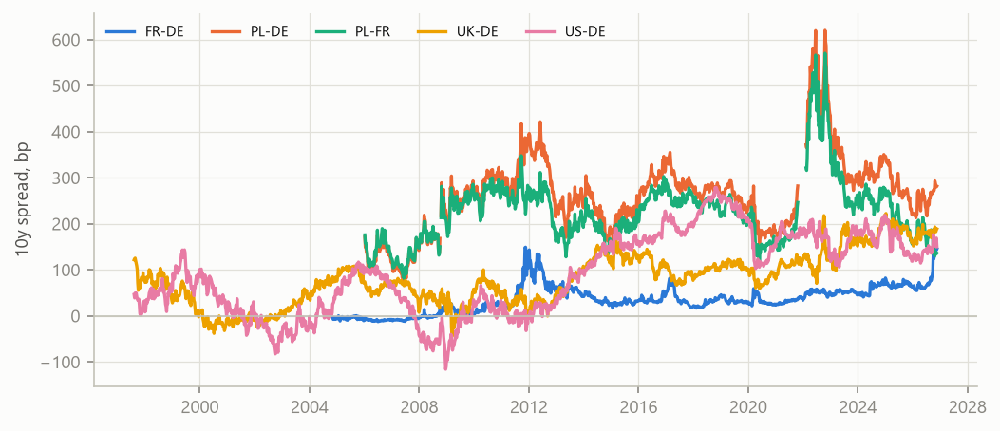

# Country comparison (2026-11-20)

Par yields in each market's own convention; forwards from the bootstrapped zero curve (they
include term premia, so they are not pure expectations); inflation from the BIS CPI series
(latest month 2026-09); fiscal data from the OECD Economic Outlook; hedged yields by
covered interest parity with overnight or policy rates as the short-rate proxy.

| measure | US | DE | FR | UK | JP | PL |
|---|---:|---:|---:|---:|---:|---:|
| 2y | 4.63 | 3.13 | 3.64 | 4.78 | 1.85 | 4.64 |
| 10y | 4.92 | 3.42 | 4.87 | 5.31 | 2.87 | 6.24 |
| 30y (Poland: none) | 5.31 | 3.77 | 5.43 | 5.72 | 4.03 |  |
| 2s10s (bp) | 29.00 | 29.37 | 123.80 | 52.51 | 101.70 | 159.46 |
| policy rate | 3.88 | 2.50 | 2.50 | 4.00 | 1.25 | 3.75 |
| 1y1y forward | 4.81 | 3.23 | 3.92 | 5.14 | 2.06 | 5.36 |
| 5y5y forward | 5.85 | 4.00 | 6.40 | 6.54 | 3.95 | 8.07 |
| CPI y/y | 3.74 | 3.26 | 3.08 | 3.45 | 2.10 | 3.97 |
| 10y minus CPI | 1.18 | 0.16 | 1.79 | 1.86 | 0.77 | 2.27 |
| 10y real (linkers) | 2.77 |  |  | 2.09 |  |  |
| 10y breakeven | 2.15 |  |  | 3.22 |  |  |
| debt % GDP 2025 | 125.92 | 62.65 | 116.75 | 102.31 | 197.52 | 73.14 |
| debt % GDP 2027 (proj.) | 131.25 | 67.11 | 121.67 | 105.44 | 188.85 | 81.06 |
| net lending % GDP 2025 | -7.27 | -2.65 | -5.11 | -5.46 | -1.00 | -7.27 |
| 10y vs Germany (bp) | 149.99 | 0.00 | 145.39 | 182.66 | -61.18 | 281.60 |
| 10y vol, 1y (bp/yr) | 72.03 | 63.08 | 84.08 | 84.68 | 55.41 | 112.24 |
| 10y hedged into EUR | 3.45 | 3.42 | 4.87 | 3.75 | 4.06 | 4.93 |
| 10y hedged into USD | 4.92 | 4.89 | 6.34 | 5.22 | 5.53 | 6.40 |

What the table shows:

- **Curve shape.** The steepest 2s10s curve is Poland (159 bp); the US and
  Germany are the flattest (29 and 29 bp).
- **Policy paths.** Every curve prices a higher one-year rate a year ahead than today
  (1y1y above the 1-year rate), most of all Poland (139 bp) - partly term premium.
- **Spreads.** France trades 145 bp over Germany at 10 years; Poland
  282 bp, the UK 183 bp and the US 150 bp
  (across currencies these are not credit spreads).
- **Hedged into euros**, the highest 10y yields are PL 4.93%, FR 4.87%, JP 4.06%: once
  the short-rate differential is paid away, Poland's pickup over France is small.
- **Fiscal.** Japan, the US and France have the highest debt ratios; Poland's is lower but
  rising fastest in the OECD projections (73.1% in 2025 to 81.1% in 2027).

Generated table: [generated/05_country_comparison.md](generated/05_country_comparison.md).
