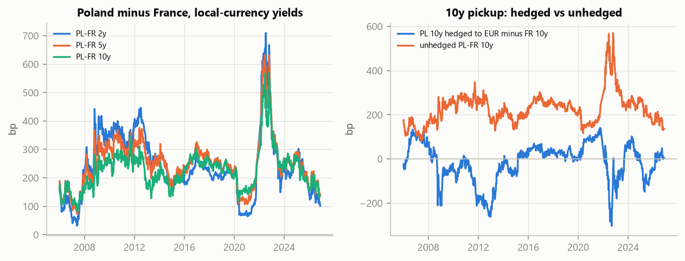
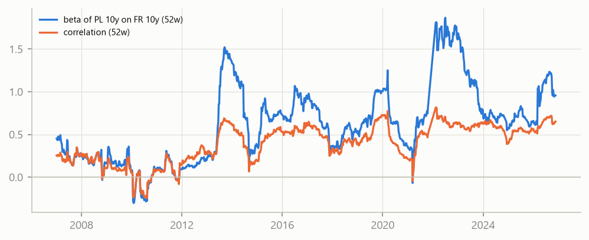

# France versus Poland

**Why this pair.** France and Poland borrow in different currencies under different central
banks, and their fiscal paths differ: France has the higher debt ratio, Poland the larger
deficit and the faster-rising debt. A spread between them mixes currency, policy,
inflation, fiscal risk and liquidity. This note lays out the evidence and tests candidate
trades with the same machinery as the rest of the project. **It does not start from, or
arrive at, a trading call.**

**Data.** France: Banque de France TEC constant-maturity yields (daily, sampled weekly).
Poland: curves fitted every week to the BondSpot fixing of Polish government bonds
(2006-2026). Funding: EUR STR and the NBP reference rate. FX: ECB EUR/PLN.

## Where the spreads stand (2026-11-20)

| spread (bp) | now | 1y ago | 5y mean | 5y min | 5y max | z (5y) |
|---|---:|---:|---:|---:|---:|---:|
| PL-FR 2y | 100.6 | 189.5 | 281.8 | 100.6 | 709.6 | -1.2 |
| PL-FR 5y | 143.8 | 200.3 | 289.4 | 139.1 | 632.9 | -1.2 |
| PL-FR 10y | 136.2 | 184.2 | 271.4 | 130.0 | 570.2 | -1.4 |
| PL 2s10s | 159.5 | 119.7 | 56.5 | -101.1 | 164.2 | 1.6 |
| FR 2s10s | 123.8 | 125.0 | 66.9 | -30.0 | 145.0 | 1.1 |
| slope gap (PL-FR 2s10s) | 35.7 | -5.3 | -10.4 | -201.6 | 88.7 | 0.8 |

The Poland-France spread is near the low end of its five-year range at every tenor, after
the 2022 spike when Polish inflation and policy rates rose far faster than euro-area ones.
Both curves are steep; Poland's 2s10s is at the top of its five-year range.

## Co-movement and currency

- 52-week beta of Polish on French 10y yield changes: 0.96 (five-year median 0.89);
  correlation 0.65. Polish 10y volatility 112 bp a year vs 76 bp for France.
- Hedging PLN into EUR costs about the short-rate differential: 3.75% - 2.44% =
  1.31% a year. Hedged, the Polish 10y yields 4.93% vs 4.87% for France:
  a pickup of 5.3 bp (five-year average -37.1 bp). Most of the unhedged spread is
  the price of the currency.

## Macro and fiscal

| year | cpi_avg_FR | debt_FR | maastricht_debt_FR | balance_FR | cpi_avg_PL | debt_PL | maastricht_debt_PL | balance_PL | policy_end_ECB | policy_end_NBP |
|---:|---:|---:|---:|---:|---:|---:|---:|---:|---:|---:|
| 2,022.00 | 5.22 | 115.50 | 111.42 | -4.75 | 14.37 | 58.81 | 48.87 | -3.37 | 2.50 | 6.75 |
| 2,023.00 | 4.89 | 116.25 | 109.65 | -5.37 | 11.61 | 62.11 | 49.58 | -5.20 | 4.50 | 5.75 |
| 2,024.00 | 2.00 | 115.56 | 113.17 | -5.79 | 3.80 | 67.18 | 55.00 | -6.47 | 3.00 | 5.75 |
| 2,025.00 | 0.94 | 116.75 | 115.96 | -5.11 | 3.87 | 73.14 | 59.78 | -7.27 | 2.00 | 4.00 |
| 2,026.00 | 1.86 | 119.57 | 118.77 | -4.96 | 2.90 | 77.37 | 64.01 | -6.87 | 2.50 | 3.75 |
| 2,027.00 |  | 121.67 | 120.87 | -4.58 |  | 81.06 | 67.71 | -6.28 |  |  |

OECD figures; 2027 and the latest year with an outturn may be projections.

## Candidate trades

Weekly backtests, P&L in bp per unit of DV01 a year, Polish costs from the fixing's bid and
offer (2.0-4.5 bp one way), French costs assumed (0.40-0.45 bp):

| trade | signal | test | ann_return_bp | ann_vol_bp | sharpe | t_nw | max_dd_bp | cost_bp_per_year |
|---|---|---|---:|---:|---:|---:|---:|---:|
| PL 10y vs FR 10y, DV01-neutral (long PL) | static | full sample | -20.54 | 104.02 | -0.20 | -0.99 | -859.78 | 19.37 |
| PL 10y vs FR 10y, DV01-neutral (long PL) | meanrev | full sample | -2.38 | 87.92 | -0.03 | -0.14 | -511.92 | 19.60 |
| PL 10y vs FR 10y, DV01-neutral (long PL) | meanrev | out-of-sample (second half) | -2.41 | 73.54 | -0.03 | -0.11 | -414.44 | 18.13 |
| PL 10y vs FR 10y, DV01-neutral (long PL) | meanrev | walk-forward OOS | 9.68 | 72.97 | 0.13 | 0.56 | -414.44 | 19.18 |
| PL 10y vs FR 10y, DV01-neutral (long PL) | carry | full sample | -14.81 | 103.76 | -0.14 | -0.70 | -454.72 | 32.75 |
| PL 5y vs FR 5y, DV01-neutral (long PL) | static | full sample | -16.63 | 112.67 | -0.15 | -0.71 | -870.26 | 23.20 |
| PL 5y vs FR 5y, DV01-neutral (long PL) | meanrev | full sample | -5.74 | 89.97 | -0.06 | -0.31 | -711.36 | 20.15 |
| PL 5y vs FR 5y, DV01-neutral (long PL) | meanrev | out-of-sample (second half) | -30.72 | 97.86 | -0.31 | -1.04 | -534.77 | 13.93 |
| PL 5y vs FR 5y, DV01-neutral (long PL) | meanrev | walk-forward OOS | -19.17 | 87.14 | -0.22 | -0.93 | -637.36 | 15.65 |
| PL 5y vs FR 5y, DV01-neutral (long PL) | carry | full sample | -19.81 | 111.19 | -0.18 | -0.87 | -731.02 | 42.10 |
| PL 2y vs FR 2y, DV01-neutral (long PL) | static | full sample | -14.00 | 112.50 | -0.12 | -0.57 | -970.17 | 39.21 |
| PL 2y vs FR 2y, DV01-neutral (long PL) | meanrev | full sample | -65.11 | 93.96 | -0.69 | -3.29 | -1,358.94 | 37.80 |
| PL 2y vs FR 2y, DV01-neutral (long PL) | meanrev | out-of-sample (second half) | -70.88 | 94.02 | -0.75 | -2.46 | -799.62 | 24.96 |
| PL 2y vs FR 2y, DV01-neutral (long PL) | meanrev | walk-forward OOS | -43.43 | 90.75 | -0.48 | -1.92 | -992.09 | 25.28 |
| PL 2y vs FR 2y, DV01-neutral (long PL) | carry | full sample | -39.39 | 110.33 | -0.36 | -1.63 | -1,193.52 | 67.85 |
| Curve box: PL 2s10s steepener vs FR 2s10s flattener | static | full sample | -31.75 | 84.76 | -0.37 | -1.78 | -782.42 | 58.11 |
| Curve box: PL 2s10s steepener vs FR 2s10s flattener | meanrev | full sample | -60.03 | 70.11 | -0.86 | -4.09 | -1,262.91 | 59.87 |
| Curve box: PL 2s10s steepener vs FR 2s10s flattener | meanrev | out-of-sample (second half) | -13.84 | 58.68 | -0.24 | -0.79 | -258.45 | 25.80 |
| Curve box: PL 2s10s steepener vs FR 2s10s flattener | meanrev | walk-forward OOS | -24.59 | 60.22 | -0.41 | -1.76 | -559.48 | 32.25 |
| Curve box: PL 2s10s steepener vs FR 2s10s flattener | carry | full sample | -69.63 | 85.54 | -0.81 | -3.89 | -1,470.89 | 116.57 |
| PL 2s10s steepener | static | full sample | -34.40 | 73.76 | -0.47 | -2.22 | -858.22 | 51.39 |
| PL 2s10s steepener | meanrev | full sample | -54.10 | 60.22 | -0.90 | -4.29 | -1,129.54 | 45.16 |
| PL 2s10s steepener | meanrev | out-of-sample (second half) | -32.46 | 68.37 | -0.47 | -1.64 | -404.14 | 41.93 |
| PL 2s10s steepener | meanrev | walk-forward OOS | -32.12 | 61.91 | -0.52 | -2.27 | -562.55 | 38.54 |
| PL 2s10s steepener | carry | full sample | -83.66 | 77.28 | -1.08 | -4.88 | -1,778.84 | 94.99 |
| FR 2s10s steepener | static | full sample | -19.98 | 56.05 | -0.36 | -1.76 | -618.57 | 6.82 |
| FR 2s10s steepener | meanrev | full sample | -20.20 | 45.54 | -0.44 | -2.20 | -489.30 | 6.63 |
| FR 2s10s steepener | meanrev | out-of-sample (second half) | -24.13 | 49.78 | -0.48 | -1.94 | -357.05 | 6.40 |
| FR 2s10s steepener | meanrev | walk-forward OOS | -20.09 | 53.41 | -0.38 | -1.76 | -451.23 | 6.93 |
| FR 2s10s steepener | carry | full sample | 24.97 | 56.00 | 0.45 | 2.23 | -141.31 | 10.76 |

The best walk-forward result is **PL 10y vs FR 10y, DV01-neutral (long PL)** (9.7 bp a year, Sharpe
0.13, t 0.56): not distinguishable from zero.

Holding the spread statically (long Poland) returned -1.2 bp a year before costs at 10
years (about nothing), 6.6 at 5 and 25.2 at 2. Costs of 19.4, 23.2 and
39.2 bp a year make all three negative; they come mostly from rolling the Polish leg
every quarter at the bid/offer measured in the fixing. An investor who rolls less often pays
less, so for the 2- and 5-year static trades the cost assumption, not the spread, decides
the sign of the result.

## What would have to be true

For a long Poland / short France 10y trade to work from here, Polish yields would have to
fall relative to French ones beyond what the forwards already price - for example, through
Polish inflation and policy rates falling faster than euro-area ones, or French fiscal risk
being repriced. Against it: the spread is already near its five-year low, the hedged pickup
is close to zero, and Poland's deficits and debt path are the larger fiscal risk in the OECD
projections. The opposite trade has the mirror-image case. The framework measures carry,
roll-down, volatility, beta and history for either side; it does not choose one.

Generated tables: [generated/06_france_vs_poland.md](generated/06_france_vs_poland.md) and `generated/frpl_*.csv`.
